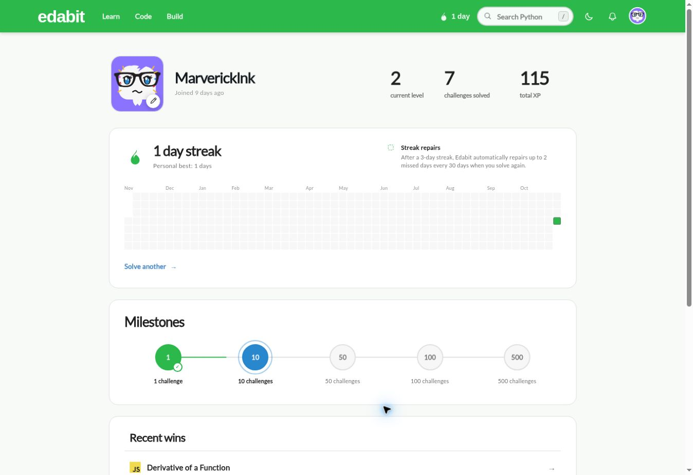

# Edabit Checkpoint

JavaScript problem solving for the GoMyCode checkpoint.

## Verified progress

- Profile: https://edabit.com/user/LXLvDfrwRyxBLWJBn
- Username: Marvericklnk
- Total XP: **115**
- Level: **2**
- Challenges solved: **7**
- Difficulties practiced: Very Easy, Easy, and Medium
- Verified on October 28, 2026.

## Completed challenges

| Challenge | Difficulty | XP |
| --- | --- | --- |
| [Return the Sum of Two Numbers](https://edabit.com/challenge/3LpBLgNRyaHMvNb4j) | Very Easy | 5 |
| [Fix the Lowest Reading](https://edabit.com/challenge/ccv2_2af9bfbe5f81fb6886d0f347) | Easy | 10 |
| [How Much is True?](https://edabit.com/challenge/GLbuMfTtDWwDv2F73) | Medium | 20 |
| [A Redundant Function](https://edabit.com/challenge/hzxN9bAebBPNqdQto) | Medium | 20 |
| [Right Shift by Division](https://edabit.com/challenge/ALGbgMWLuEdrh22fB) | Medium | 20 |
| [Find Number of Digits in Number](https://edabit.com/challenge/yFJzLfYghz7ZtsyAN) | Medium | 20 |
| [Derivative of a Function](https://edabit.com/challenge/Bxp6uGjgmf8TuG8Fe) | Medium | 20 |

All seven solutions passed Edabit's checks. See [solutions.js](solutions.js) for the submitted functions.

This submission was prepared with AI assistance, including challenge solutions and browser submissions. The screenshot records the actual resulting Edabit profile.
